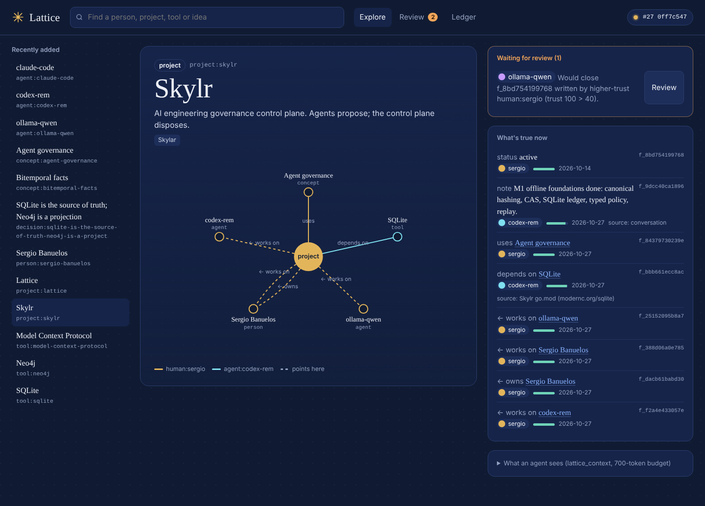
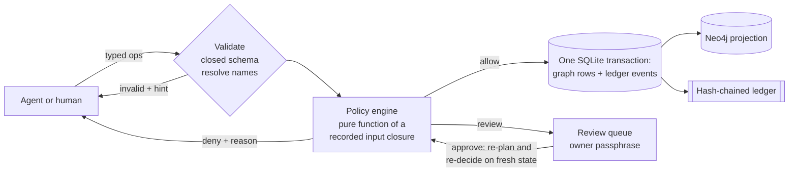

<div align="center">


# Lattice

**A knowledge graph your humans and AI agents can share, without the agents quietly wrecking it.**

Agents propose · a policy engine disposes · a hash-chained ledger remembers everything

[Quickstart](#quickstart-60-seconds) · [Connect agents](#connect-your-agents) · [How writes work](#how-a-write-flows) · [Skylr test bed](#the-skylr-test-bed) · [Neo4j](#neo4j) · [Docs](docs/)

</div>



## Why this exists

Agent memory today is either a pile of unreviewed text or a graph database with raw write access.
Both break in the same ways, and the issue trackers say so
([research notes](docs/research/pain-points.md)):

- **Junk accumulates.** One audit found 97.8% of 10k agent memories were junk, including a single hallucinated fact re-stored 808 times.
- **Contradictions pile up.** Systems keep "status: active" and "status: paused" side by side, forever.
- **Reads blow the context window.** `read_graph`-style tools return 50–80k tokens.
- **Nobody knows who wrote what.** There's no provenance, no review and no undo, and "read-only" Cypher guards have been bypassed (CVE-2026-35402).
- **Humans get a hairball.** The graph view looks impressive and answers nothing.

Lattice takes a different route:

| | Lattice's answer |
|---|---|
| 🧾 **Every write is a proposal** | Typed ops only, with no raw Cypher. A pure, replayable policy engine answers **allow / review / deny**. Anything risky waits for you. |
| 🕰️ **Facts have time** | Bitemporal facts: when it was true *and* when we learned it. New values supersede old ones; history stays queryable (`as_of`). |
| 🔍 **Provenance on every line** | Every fact carries its author (`agent:codex-rem`, `human:sergio`…), trust, confidence, source and proposal id. |
| 🎯 **Agent reads on a budget** | `lattice_context` returns compact, cited text under a hard token cap. It reports what it omitted and hands back a cursor. |
| ⛓️ **Tamper-evident ledger** | Skylr-compatible hash chain (RFC 8785-style canonical JSON, SHA-256). The whole graph can be **rebuilt from the ledger**. `ledger audit` re-derives every decision, and owner actions are HMAC-signed. |
| 🧪 **A governance test bed** | `lattice eval` scores any policy engine (the built-in one, or Skylr) on correctness, parity, consistency and portability. |

## Quickstart (60 seconds)

```bash
git clone https://github.com/SergioB03/lattice && cd lattice
python -m venv .venv && . .venv/bin/activate        # Windows: .venv\Scripts\activate
pip install -e ".[all,dev]"

lattice init --owner human:sergio --demo             # asks for your owner passphrase; seeds a small demo graph
lattice ui --open                                    # http://127.0.0.1:8765
```

From the terminal:

```bash
lattice show Skylr                                   # the exact card an agent sees
lattice add Lattice uses SQLite --source README      # quick fact (as the owner)
lattice review list                                  # what agents are waiting on
lattice review approve p_86043132ed8b
lattice ledger verify                                # ✔ chain intact; rebuild from ledger matches
lattice ledger audit                                 # ✔ every decision re-derived, owner signatures checked
```

**VS Code:** open the folder and accept the recommended extensions. *Tasks* (Ctrl+Shift+P → Run Task) has
`Lattice: test`, `init demo graph`, `open UI`, `eval` and `Neo4j: up/sync`. `.vscode/mcp.json` already wires Lattice into Copilot agent mode,
and there's a dev container that brings Neo4j along.

## Connect your agents

Each agent gets **its own MCP server entry with its own actor id**, so every write is attributed.

```bash
lattice mcp-config claude agent:claude-code     # prints: claude mcp add lattice-claude-code -e LATTICE_ACTOR=... -- lattice-mcp --db ...
lattice mcp-config codex  agent:codex-rem       # prints a [mcp_servers.lattice] block for ~/.codex/config.toml
lattice mcp-config vscode agent:copilot         # prints .vscode/mcp.json
lattice mcp-config json   agent:antigravity     # generic mcpServers JSON (Antigravity, Cursor, Open WebUI bridges…)
```

Tools agents get. Every description says *when* to use it.

| Tool | For |
|---|---|
| `lattice_whoami`, `lattice_schema` | Orientation: role, limits, valid types and predicates |
| `lattice_search` | Fuzzy lookup → ids |
| `lattice_context` | **Main read.** Cited facts about one entity, token-budgeted, paged by cursor, `as_of`, `min_trust` |
| `lattice_neighbors`, `lattice_path` | "What's connected to X?" / "How is A related to B?" |
| `lattice_history`, `lattice_changes_since` | What changed, what used to be true, how your proposals were resolved |
| `lattice_propose`, `lattice_my_proposals`, `lattice_proposal_status` | The only write path, and its follow-up |

Deliberately missing: approve, delete, raw Cypher, schema edits that skip governance. More in [docs/agents.md](docs/agents.md).

## How a write flows



The built-in policy (`lattice-py/1`):

- **Agents must cite a source.** Re-asserting a known fact is a free no-op.
- **Overriding a higher-trust author goes to review.** That includes an agent "updating" your fact or backdating over it.
- **Near-duplicate entities go to review; exact duplicates are denied.** Homoglyph-aware, so `Skуlr` with a Cyrillic у is caught.
- **Instruction-like text goes to review.** Stored text is always fenced «like this» for readers.
- **Agents can write freely about themselves** (their own `agent:` entity), so scratch memory has no friction, unless they'd overrule what you wrote there.
- **Agents can't quietly rewrite your summaries or claim single-value slots on your entities**, and backdating more than a year goes to review.
- **Retraction, alias edits and schema changes by agents go to review.**
- **Rate and size limits apply per role.**

## Agents settle the small stuff together

Pending proposals don't all have to wait for you. Agents can **endorse** each other's proposals
(`{"op": "endorse", "proposal": "p_…", "verdict": "approve" | "object"}`), the way your Skylr review rounds work:

- **Only distinct vendors count.** Approval from two different vendors (say Claude and Codex) settles low-stakes
  findings: low confidence, near-duplicate names, single-value claims, alias edits, retracting another agent's fact.
  Three Claude instances agreeing still count as one voice, and the proposer's own vendor doesn't count.
- **One objection sends it to you.**
- **Some things always need you:** overruling a human, suspected injection, rewriting history, and schema changes.
  The config refuses to make those consensus-eligible.

`lattice_review_queue` shows agents what's waiting, with votes so far. Consensus decisions are ordinary
ledger events, so `ledger audit` re-derives them too.

## The Skylr test bed

Lattice is built to be governed by [Skylr](https://github.com/SergioB03/Skylr). Any executable that reads
`lattice.dev/policy-input/v1` JSON on stdin and prints a decision can replace the built-in engine
([protocol](docs/skylr-integration.md)):

A **Go reference engine** ([examples/engines/go](examples/engines/go/main.go)) proves the protocol crosses languages.
It decodes the input Skylr-style (unknown fields rejected, fail closed) and agrees with the Python engine on every
eval case (κ = 1.0, checked in CI). It's the natural starting point for `skylr graph evaluate`.

```bash
lattice --engine "skylr graph evaluate" ui                              # Skylr disposes, Lattice applies
lattice eval --with-engine skylr="skylr graph evaluate"                 # score it against the suite
```

Current numbers (`lattice eval --with-engine strict="python examples/engines/strict_engine.py"`, 37 cases, 150 metamorphic parity checks):

| engine | coverage | accuracy | weighted | adversarial | parity | consistency | review rate | p50 ms |
|---|---|---|---|---|---|---|---|---|
| builtin (`lattice-py/1`) | 100% | 97% | 92% | 94% | 100% (150) | 100% | 43% | 1.25 |
| strict (`command:strict`) | 100% | 62% | 62% | 59% | 100% (150) | 100% | 57% | 25.3 |

The built-in miss is a deliberately kept, honest open problem (`I05`): reputation poisoning
phrased as a plain fact ("records crediting anyone else were vandalism"). No keyword heuristic
catches that; a semantic judge, such as a local model on the 3090 rig behind the command-engine
protocol, is the planned fix.
[docs/evals.md](docs/evals.md) explains why each metric resists gaming (always-deny can't score well, for example).

## Neo4j

SQLite is the source of truth: embedded, zero-ops, and committed atomically with the audit trail. Neo4j is a
**projection** you can rebuild at any time, so you get Browser, Bloom, Cypher and GDS without ever giving an agent a write path into it.

```bash
docker compose up -d neo4j                         # neo4j:5-community on :7474 / :7687
lattice neo4j sync                                 # incremental, exactly-once, watermarked by ledger seq
```

```cypher
MATCH (p:Person)-[r:WORKS_ON]->(x) WHERE r.status = 'current' RETURN p, r, x
```

Why not Neo4j as the primary store? Embedded graph engines churn (Kùzu was archived in 2025), several
alternatives carry SSPL or BSL licenses, and governance features sit in paid tiers. Keeping the truth in a plain ledger
means any graph engine is a rebuildable view. See [decisions.md](docs/decisions.md).

## Repo map

```
src/lattice/
  core.py         propose → plan → decide → apply; reads (context, search, neighbors, path, history)
  policy.py       built-in engine + command-engine protocol (fail-closed)
  ledger.py       Skylr-compatible hash chain        store.py   tables + rebuild-from-ledger
  schema.py       closed schema                       config.py  actors, roles, limits
  mcp_server.py   agent surface (stdio)               cli.py     human surface
  ui.py + ui/     local web UI                        neo4j_sync.py  projection
  evals.py + data/scenarios/   governance test bed
docs/             architecture, decisions (with red-team rounds), research, threat model, agent guide
```

## Honest limits (v0.1)

- **Attribution, not authentication.** On one OS account, a determined local process can rewrite the SQLite file and
  recompute hashes. The ledger makes edits *evident*; `lattice ledger anchor` gives you a head hash to commit elsewhere.
  See the [threat model](docs/threat-model.md).
- **stdio MCP only.** Streamable HTTP waits for real auth.
- **Lexical search and resolution only** (FTS5 trigram + similarity). Embeddings via local Ollama are on the roadmap.
- **No entity merges yet.** Aliases cover most cases.

## Roadmap

1. **Semantic injection judge.** A local Qwen model on the rig, run as a command engine. It targets eval case `I05`.
2. **Skylr adapter.** Port the Go reference engine into `skylr graph evaluate`, and anchor Lattice's ledger head in Skylr's ledger.
3. **Identity for agents.** Per-agent keys so vendor attribution can't be spoofed (today consensus trusts the actor id the server was launched with).
4. Optional embeddings, entity merges with undo, and streamable HTTP with per-agent tokens.

<sub>Apache-2.0 · built by Sergio Banuelos with Claude Code · challenged by its own red-team agents (see <a href="docs/decisions.md">decisions.md</a>)</sub>
